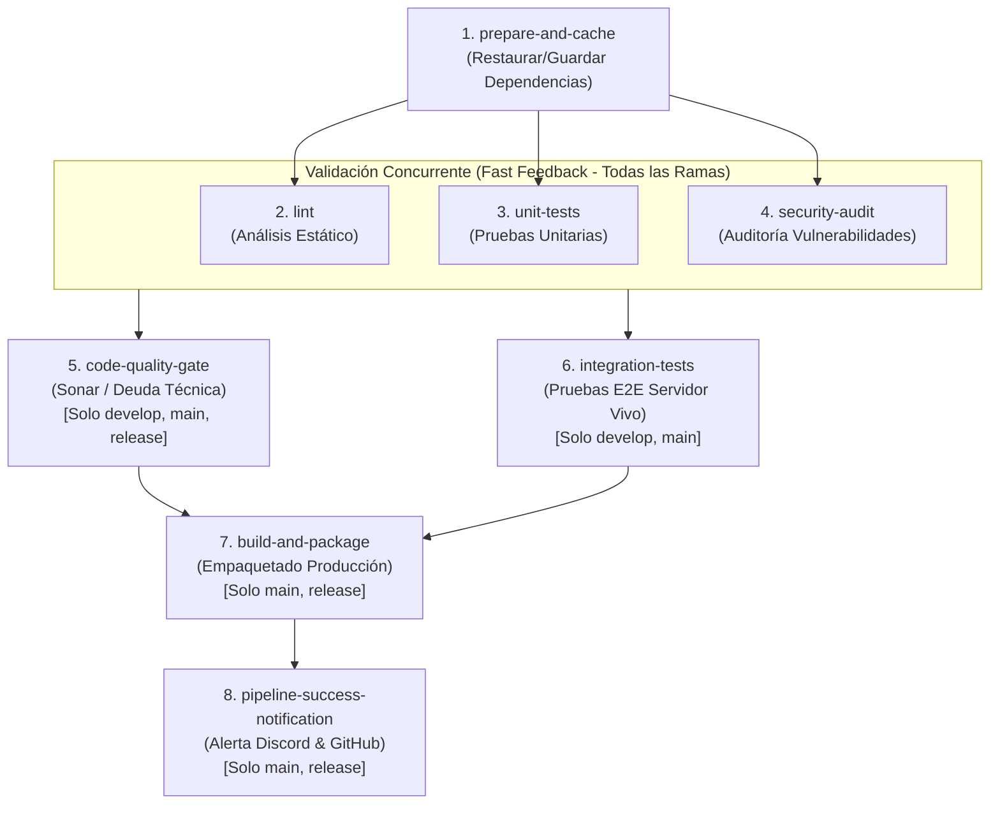

# Guía de Configuración e Implementación en CircleCI

Esta guía detalla el procedimiento completo para activar, configurar y ejecutar el pipeline CI/CD en **CircleCI** para el microservicio **DevOps Inventory Service**, replicando y optimizando las capacidades del pipeline original de Jenkins.

---

## 1. Requisitos Previos

1. Cuenta activa en [CircleCI Cloud](https://circleci.com/).
2. Acceso al repositorio en GitHub: [https://github.com/Santty111/pipepline.git](https://github.com/Santty111/pipepline.git).
3. (Opcional para notificaciones) Webhook URL de Discord y/o GitHub Personal Access Token con permisos `repo:status`.

---

## 2. Paso a Paso: Vinculación del Proyecto en CircleCI

### Paso 2.1: Iniciar Sesión en CircleCI
1. Accede a [app.circleci.com](https://app.circleci.com/).
2. Haz clic en **Log in with GitHub**.
3. Selecciona la organización o cuenta donde reside el repositorio (`Santty111`).

### Paso 2.2: Configurar el Proyecto (Set Up Project)
1. En el menú lateral izquierdo, haz clic en **Projects**.
2. Busca en la lista el repositorio: `pipepline`.
3. Haz clic en el botón azul **Set Up Project**.
4. CircleCI te preguntará por el archivo de configuración:
   - Selecciona la opción: **"Fast: Set Up with a config.yml in your repo"**.
   - Ingresa el nombre de la rama principal: `main`.
5. Haz clic en **Set Up Project**. CircleCI detectará automáticamente el archivo [.circleci/config.yml](file:///c:/.../pipepline-1/.circleci/config.yml) que ya está creado en el proyecto.

---

##  3. Configuración de Variables de Entorno (Secrets)

Para que el módulo de notificaciones envíe alertas a Discord y actualice los checks en GitHub, se deben registrar las variables de entorno en CircleCI:

1. Dentro de CircleCI, ve a la vista del proyecto `pipepline`.
2. En la esquina superior derecha, haz clic en **Project Settings** (icono de engranaje).
3. En el menú lateral izquierdo, selecciona **Environment Variables**.
4. Haz clic en **Add Environment Variable** y agrega:

| Nombre de la Variable | Valor / Descripción | Obligatorio |
| :--- | :--- | :--- |
| `DISCORD_WEBHOOK_URL` | URL completa del Webhook del canal de Discord (ej. `https://discord.com/api/webhooks/...`). | Recomendado para alertas |
| `GITHUB_TOKEN` | Personal Access Token (PAT) clásico con alcance `repo:status` para marcar con checks verdes los commits. | Opcional |

> [!NOTE]
> Si no defines estas variables, el pipeline **NO fallará**. El script modular `scripts/notify-pipeline.js` detecta automáticamente la ausencia de credenciales y continúa la ejecución sin bloquear los jobs.

---

##  4. Arquitectura del Pipeline en CircleCI

El archivo [.circleci/config.yml](file:///c:/.../pipepline-1/.circleci/config.yml) implementa una arquitectura modular con:



### Componentes Clave:
1. **Executor Reutilizable (`node-executor`):**
   - Utiliza la imagen oficial optimizada `cimg/node:20.11`.
   - Garantiza entornos efímeros limpios en cada build.
2. **Commands Modulares:**
   - `setup_workspace`: Clonado e inspección de telemetría del entorno.
   - `restore_dependencies_cache` & `save_dependencies_cache`: Manejo inteligente de dependencias basado en el checksum MD5 de `package.json`.
   - `notify_step_failure`: Disparo automático de alerta a Discord si cualquier job individual falla (`when: on_fail`).
   - `validate_quality_gate`: Inspección del reporte JSON generado por SonarQube / Code Quality.
3. **Workflow con Ejecución Selectiva:**
   - Ramas `feature/*` o `bugfix/*`: Solo ejecutan Fase 1 y Fase 2 (Fast Feedback).
   - Rama `develop`: Ejecuta Fases 1, 2 y 3 (Calidad + Integración).
   - Ramas `main` y `release/*`: Ejecutan todas las fases hasta el empaquetado y la notificación final.

---

##  5. Verificación y Validación de la Ejecución

### Caso de Prueba 1: Ejecución en Rama Principal (`main`)
1. Realiza un commit y push a la rama `main`:
   ```bash
   git add .
   git commit -m "feat: migración completa de pipeline a CircleCI con múltiples jobs y workflows"
   git push origin main
   ```
2. Ve a la consola de CircleCI (`Pipelines`).
3. **Resultado esperado:**
   - Se activan los 8 jobs en secuencia y concurrencia.
   - Los jobs `lint`, `unit-tests` y `security-audit` corren en paralelo al mismo tiempo.
   - Llega la notificación verde a Discord con los detalles del build.

### Caso de Prueba 2: Validación de Ejecución Selectiva (Rama `feature/*`)
1. Crea una rama temporal de trabajo:
   ```bash
   git checkout -b feature/optimizacion-filtros
   git push -u origin feature/optimizacion-filtros
   ```
2. Observa el workflow en CircleCI:
   - Se ejecutan: `prepare-and-cache`, `lint`, `unit-tests`, `security-audit`.
   - Los jobs `code-quality-gate`, `integration-tests`, `build-and-package` y `pipeline-success-notification` quedan **omitidos** automáticamente por los filtros de rama.
   - Tiempo de ejecución reducido a menos de 45 segundos.

---

##  6. Notificaciones para Diferentes Estados del Pipeline

El pipeline de CircleCI cubre todos los estados operativos:

1. **Estado Exitoso (`SUCCESS`):**
   - Ejecutado por el job `pipeline-success-notification` al culminar todas las fases requeridas.
   - Envía tarjeta verde a Discord con los metadatos de la entrega.
2. **Estado de Fallo (`FAILURE`):**
   - Implementado mediante el step `notify_step_failure` con la condición declarativa `when: on_fail`.
   - Si cualquier prueba, linter o auditoría falla, se captura el error de inmediato y se despacha la alerta roja a Discord y GitHub indicando exactamente qué job falló.
3. **Estado de Commit en GitHub:**
   - Se actualiza el contexto del commit (`ci/circleci: <job-name>`) con badges de aprobado o denegado.
