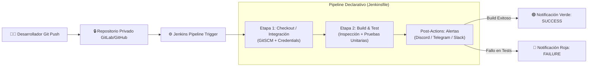

# 🚀 Guía Definitiva de Implementación CI/CD con Jenkins y Repositorio Privado

Esta guía contiene la solución integral para configurar, ejecutar y validar un **Pipeline Declarativo de CI/CD en Jenkins** conectado a un repositorio privado (**GitLab / GitHub**), con ejecución de pruebas unitarias automatizadas y sistema de alertas en tiempo real.

---

## 📐 1. Arquitectura del Flujo CI/CD

El pipeline implementa una arquitectura secuencial y resiliente siguiendo los estándares modernos de DevOps:



---

## 🔑 2. Configuración de Acceso al Repositorio Privado

Para que Jenkins clone un repositorio privado sin exponer contraseñas en texto plano, se deben registrar credenciales en el almacén cifrado de Jenkins.

### Opción A: Personal Access Token (PAT) - Recomendado HTTPS
1. **Generar Token en GitLab / GitHub:**
   - **GitLab:** Ve a `User Settings` ➔ `Access Tokens` ➔ `Add new token`. Asigna nombre (ej: `jenkins-ci-token`) y marca los scopes: `read_repository` (o `api` si usas webhooks avanzados).
   - **GitHub:** Ve a `Settings` ➔ `Developer Settings` ➔ `Personal access tokens (Tokens classic)` ➔ Marca `repo`.
2. **Cargar Credencial en Jenkins:**
   - En el menú principal de Jenkins, haz clic en **Administrar Jenkins** (`Manage Jenkins`).
   - Ve a **Credentials** ➔ **System** ➔ **Global credentials (unrestricted)**.
   - Haz clic en **Add Credentials** (o *Agregar credenciales*).
   - Configura los campos:
     - **Kind (Tipo):** `Username with password`
     - **Username:** Tu nombre de usuario de GitLab/GitHub (o el token name).
     - **Password:** Pega aquí el Personal Access Token generado.
     - **ID:** `gitlab-private-repo-creds` *(Este identificador exacto se usa en el Jenkinsfile)*.
     - **Description:** `Credenciales de acceso lectura para repo privado GitLab`.
   - Haz clic en **Create**.

### Opción B: Llave SSH (Alternativa)
1. Genera el par de llaves en tu máquina o servidor Jenkins:
   ```bash
   ssh-keygen -t ed25519 -C "jenkins@ci-cd" -f ~/.ssh/jenkins_gitlab_key
   ```
2. Sube la clave pública (`jenkins_gitlab_key.pub`) en **GitLab/GitHub** (`Settings` ➔ `SSH Keys`).
3. En Jenkins:
   - **Kind:** `SSH Username with private key`
   - **ID:** `gitlab-private-repo-creds`
   - **Username:** `git`
   - **Private Key:** Pega el contenido de la clave privada (`jenkins_gitlab_key`).

### Sintaxis Declarativa de `checkout` en el Pipeline
En el `Jenkinsfile`, el checkout seguro se realiza mediante la siguiente sintaxis:

```groovy
checkout([
    $class: 'GitSCM',
    branches: [[name: "*/${env.REPO_BRANCH}"]],
    doGenerateSubmoduleConfigurations: false,
    extensions: [
        [$class: 'CleanBeforeCheckout'], // Limpia archivos temporales de builds previos
        [$class: 'PruneStaleBranch']     // Elimina ramas remotas que ya fueron borradas
    ],
    submoduleCfg: [],
    userRemoteConfigs: [[
        credentialsId: "${env.GIT_CREDENTIALS_ID}",
        url: "${env.REPO_URL}"
    ]]
])
```

---

## 🛠️ 3. Configuración del Canal de Notificaciones (Post-Actions)

Usamos un **Webhook de Discord** (o bot de Telegram) por su simplicidad, disponibilidad gratuita e integración vía `curl` sin requerir infraestructura externa de correo:

1. **Crear Webhook en Discord:**
   - En tu servidor de Discord, entra en los ajustes de un canal (ej. `#deployments` o `#ci-cd-alerts`) ➔ **Integraciones** ➔ **Webhooks** ➔ **Nuevo Webhook**.
   - Copia la URL del Webhook (ej. `https://discord.com/api/webhooks/123456/abcdef...`).
2. **Registrar el Secreto en Jenkins:**
   - Ve a **Administrar Jenkins** ➔ **Credentials** ➔ **System** ➔ **Global credentials (unrestricted)** ➔ **Add Credentials**.
   - **Kind:** `Secret text`
   - **Secret:** Pega la URL completa del Webhook.
   - **ID:** `devops-discord-webhook`
   - **Description:** `Webhook de notificaciones Discord para Jenkins CI/CD`.
   - Haz clic en **Create**.

> 💡 **Nota de Seguridad:** Con el bloque `withCredentials([string(credentialsId: ..., variable: 'WEBHOOK_URL')])`, Jenkins automáticamente enmascara la URL en la salida de consola reemplazándola por `****`.

---

## 📋 4. Guía Paso a Paso para Crear el Job en Jenkins UI

### Paso 4.1: Validar Plugins Instalados
Ve a **Administrar Jenkins** ➔ **Plugins** ➔ **Installed Plugins** y confirma la presencia de:
- `Pipeline` (Workflow Aggregator)
- `Git plugin`
- `Credentials Binding Plugin`

*(La mayoría vienen incluidos por defecto en la instalación estándar de Jenkins).*

### Paso 4.2: Creación del Job tipo "Pipeline"
1. En el Dashboard de Jenkins, haz clic en **Nueva Tarea** (`New Item`).
2. Ingresa un nombre representativo: `pipeline-privado-ci-cd`.
3. Selecciona el tipo **Pipeline** y presiona **OK**.
4. En la pestaña de configuración:
   - *(Opcional)* En **General**, marca **Discard old builds** (Mantener últimos 10 builds).
5. Desplázate hasta la sección **Pipeline**:
   - **Opción Recomendada (Pipeline script from SCM):**
     - **Definition:** `Pipeline script from SCM`
     - **SCM:** `Git`
     - **Repository URL:** `https://gitlab.com/tu-usuario/tu-repo.git`
     - **Credentials:** Selecciona `gitlab-private-repo-creds` del menú desplegable.
     - **Branch Specifier:** `*/main`
     - **Script Path:** `Jenkinsfile`
   - **Opción Directa (Pipeline script):**
     - Si deseas probarlo sin pushear primero el archivo, selecciona `Pipeline script` y copia/pega el contenido del [Jenkinsfile](file:///Users/sannsann/Desktop/pipline/Jenkinsfile) ajustando las variables `REPO_URL` y `REPO_BRANCH`.
6. Haz clic en **Guardar** (`Save`).

---

## 🧪 5. Validación y Protocolo de Pruebas Obligatorio

Para certificar que el pipeline está listo para producción, se deben ejecutar tres pruebas formales:

### 🟢 Prueba 1: Ejecución Exitosa (Happy Path)
1. Entra al job en Jenkins y haz clic en **Construir ahora** (`Build Now`).
2. Observa el gráfico **Stage View**:
   - `Checkout / Integración`: Debe completarse en verde en pocos segundos.
   - `Build & Test Automatizado`: Debe compilar y ejecutar las pruebas unitarias (`✔ sumar()`, `✔ validarEmail()`) reportando 0 fallos.
   - Post-action `success`: Debe activarse.
3. **Verificación Externa:** Abre el canal de Discord. Debe llegar un mensaje con recuadro verde que indique:
   - `✅ Pipeline Exitoso: pipeline-privado-ci-cd`
   - `Build N°: #1`
   - `Resultado: SUCCESS`
   - Enlace directo al Build.

---

### 🔴 Prueba 2: Forzado Intencional de Fallo (Chaos & Failure Alert Test)
El objetivo es verificar que si un desarrollador introduce un bug, el pipeline bloquea el ciclo y dispara la alerta roja.

1. Abre el archivo de pruebas [`index.test.js`](file:///Users/sannsann/Desktop/pipline/index.test.js).
2. Modifica intencionalmente una aserción para forzar el error:
   ```diff
   - assert.strictEqual(sumar(2, 3), 5);
   + assert.strictEqual(sumar(2, 3), 999); // Error provocado
   ```
3. Guarda el cambio y haz commit/push a tu rama o ejecuta **Construir ahora** (`Build Now`).
4. **Comportamiento esperado en Jenkins:**
   - La etapa `Checkout / Integración` finaliza en verde.
   - La etapa `Build & Test Automatizado` **falla inmediatamente** y se marca en **rojo** (código de salida != 0).
   - El pipeline **se detiene**, impidiendo cualquier fase posterior.
   - La sección `failure` en `post` se dispara automáticamente.
5. **Verificación Externa:**
   - En Discord llega una alerta roja:
     - `❌ Pipeline Fallido: pipeline-privado-ci-cd`
     - `Resultado: FAILURE`
     - Enlace a la consola de logs.
6. **Restauración:** Vuelve a corregir el valor a `5` para restablecer el estado saludable.

---

### 🔍 Prueba 3: Auditoría y Revisión de Logs de Consola
1. En el build fallido o exitoso, haz clic en el número de build (ej. `#2`) y luego en **Salida de consola** (`Console Output`).
2. **Puntos clave a auditar:**
   - **Enmascaramiento de Secretos:** Confirma que la variable de entorno del webhook o token no aparezca en texto legible:
     ```text
     [withCredentials] Credentials successfully retrieved
     [withCredentials] Injecting password to [WEBHOOK_URL]
     ...
     curl -s -X POST -H "Content-Type: application/json" ... "****"
     ```
   - **Trazabilidad de Git:** Verifica que aparezca el autor y hash del commit descargado:
     ```text
     Commit: a1b2c3d | Autor: Desarrollador <dev@empresa.com> | Mensaje: feat: implementacion de login
     ```
   - **Diagnóstico del Test Fallido:** En el build con fallo provocado, el log debe señalar con exactitud la línea del fallo:
     ```text
     AssertionError [ERR_ASSERTION]: Expected values to be strictly equal:
     5 !== 999
     at TestContext.<anonymous> (index.test.js:6:12)
     ```

---

## 📦 6. Archivos del Proyecto Listos para Usar

En este workspace cuentas con los siguientes archivos listos para clonar o subir a tu repositorio:
- [`Jenkinsfile`](file:///Users/sannsann/Desktop/pipline/Jenkinsfile): Pipeline declarativo completo con 3 etapas y post-actions.
- [`package.json`](file:///Users/sannsann/Desktop/pipline/package.json): Definición del proyecto.
- [`index.js`](file:///Users/sannsann/Desktop/pipline/index.js): Código de negocio fuente.
- [`index.test.js`](file:///Users/sannsann/Desktop/pipline/index.test.js): Suite de pruebas unitarias automatizadas.
