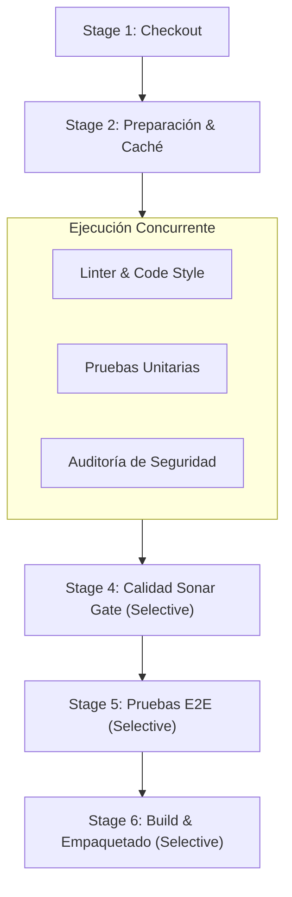

# 🚀 Pipeline CI/CD Empresarial Optimizado con Jenkins y GitHub

Esta documentación describe la solución avanzada implementada para el **Microservicio de Gestión de Inventario y Operaciones CI/CD**, aplicando las mejores prácticas de **optimización de pipelines**, **estrategias de branching**, **análisis de calidad de código** y **notificaciones automatizadas a GitHub y Discord**.

---

## 🏗️ 1. Arquitectura del Proyecto Funcional

El repositorio aloja un microservicio REST en Node.js de producción con enrutamiento nativo, métricas de observabilidad y control de stock:

```
├── pipeline/
│   └── modules/
│       ├── notifications.groovy        # Módulo Groovy desacoplado: GitHub Status & Discord
│       └── qualityGate.groovy          # Módulo Groovy desacoplado: Inspección Quality Gate
├── src/
│   ├── app.js                          # Servidor HTTP REST, enrutamiento, CORS y métricas
│   ├── server.js                       # Entrypoint con graceful shutdown
│   ├── controllers/
│   │   ├── productController.js        # Lógica de negocio (catálogo, filtros, stock)
│   │   └── authController.js           # Autenticación y generación de tokens de sesión
│   └── validators/
│       └── schemaValidator.js          # Validador estricto de esquemas de datos
├── scripts/
│   ├── linter.js                       # Análisis estático de código y estilo (Linter)
│   └── code-quality.js                 # Evaluador de SonarQube / Quality Gate
├── tests/
│   ├── unit/                           # Pruebas unitarias
│   └── integration/                    # Pruebas End-to-End (E2E) con servidor HTTP en vivo
├── Jenkinsfile                         # Orquestador Declarativo Modular
└── package.json                        # Definición y scripts del microservicio
```

---

## ⚡ 2. Estrategias de Optimización Implementadas

### A. Ejecución Paralela (`parallel`)
En lugar de ejecutar las pruebas de manera secuencial (esperando que una termine para que empiece la otra), la etapa **`Validación Paralela (Fast Feedback)`** ejecuta simultáneamente:
1. **Linter & Code Style:** `npm run lint`
2. **Pruebas Unitarias:** `npm run test:unit`
3. **Auditoría de Seguridad:** `npm run audit`

> ⏱️ **Beneficio:** Reduce el tiempo del ciclo de retroalimentación (feedback loop) en más de un **50%**.



---

### B. Estrategia de Branching y Ejecución Selectiva (`when`)
El pipeline adapta su comportamiento automáticamente según la rama de trabajo:

| Rama | Comportamiento del Pipeline | Etapas que se Ejecutan |
| :--- | :--- | :--- |
| **`feature/*` / `bugfix/*`** | **Fast Feedback:** Validación ágil de código antes de hacer Pull Request. | Checkout ➔ Preparación ➔ Validación Paralela. *(Omite Sonar, E2E y Build).* |
| **`develop`** | **Integración Continua:** Pruebas profundas de integración del equipo. | Checkout ➔ Preparación ➔ Validación Paralela ➔ Sonar Quality Gate ➔ Pruebas E2E. |
| **`main` / `release/*`** | **Entrega Continua (CD):** Validación exhaustiva y empaquetado para producción. | **Todas las etapas:** Checkout ➔ Preparación ➔ Validación Paralela ➔ Sonar Gate ➔ Pruebas E2E ➔ **Build & Empaquetado**. |

---

### C. Caché Inteligente de Dependencias
Se analiza el hash MD5 de `package.json` para evitar descargas o preparaciones redundantes si los manifiestos no han cambiado.

---

### D. Modularidad y Funciones Reutilizables
El `Jenkinsfile` desacopla la lógica compleja en funciones Groovy parametrizadas:
- `actualizarStatusGitHub(estado, descripcion)`: Interactúa con la API REST de GitHub.
- `enviarNotificacionDiscord(estado, color, descripcion)`: Genera tarjetas visuales enriquecidas.

---

## 🔔 3. Notificaciones Multi-Canal (Post-Actions)

Al finalizar el pipeline (en los bloques `always`, `success` y `failure`), se disparan dos acciones automáticas:

1. **Notificación en GitHub (Commit Status API):**
   - Utiliza el Personal Access Token de la credencial `gitlab-private-repo-creds`.
   - Envía un `POST` a `https://api.github.com/repos/Santty111/pipepline/statuses/<COMMIT_SHA>`.
   - Muestra un badge visual de checkmark verde (`success`) o cruz roja (`failure`) **directamente al lado del commit en la web de GitHub**.
2. **Notificación en Discord Webhook:**
   - Envía un mensaje con recuadro verde (éxito) o rojo (fallo), número de build, rama, commit y enlace a los logs.

---

## 🧪 4. Guía de Pruebas y Validación

### Prueba 1: Ejecución en Rama Principal (`main`)
1. Haz commit y push en `main`.
2. En Jenkins, haz clic en **Construir ahora** (`Build Now`).
3. **Resultado:** Se ejecutan **las 6 etapas** secuenciales y paralelas. En Discord llega el mensaje verde y en GitHub el commit se marca con un check verde ✅.

### Prueba 2: Comprobación de Ejecución Selectiva (Rama Feature)
1. Crea una rama temporal desde tu terminal:
   ```bash
   git checkout -b feature/nuevo-filtro
   git push -u origin feature/nuevo-filtro
   ```
2. Ejecuta el build en Jenkins seleccionando esta rama (o con Multibranch Pipeline).
3. **Resultado:** Las etapas de *Calidad Sonar*, *E2E* y *Build* se marcarán como omitidas (*Skipped due to when conditional*), acelerando la entrega.
